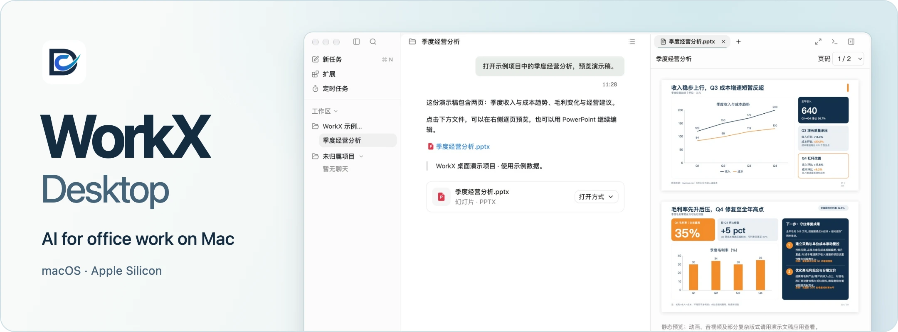
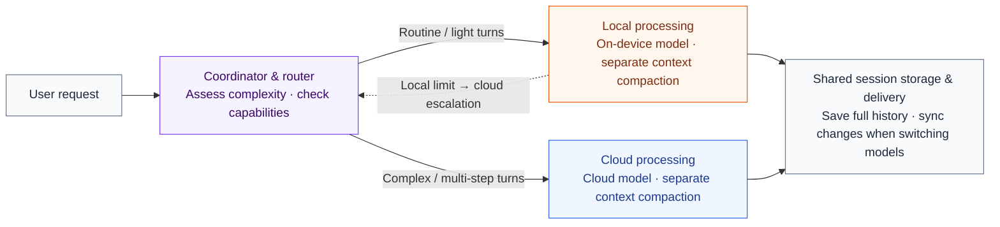

<!--
  Licensed to the Apache Software Foundation (ASF) under one
  or more contributor license agreements.  The ASF licenses this file
  to you under the Apache License, Version 2.0 (the
  "License"); you may not use this file except in compliance
  with the License.  You may obtain a copy of the License at

      http://www.apache.org/licenses/LICENSE-2.0

  Unless required by applicable law or agreed to in writing,
  software distributed under the License is distributed on an
  "AS IS" BASIS, WITHOUT WARRANTIES OR CONDITIONS OF ANY
  KIND, either express or implied.  See the License for the
  specific language governing permissions and limitations
  under the License.
-->

<h1 align="center">WorkX Desktop</h1>

  <a href="docs/readme/workx-desktop.png">
    <picture>
      <source media="(max-width: 600px)" srcset="docs/readme/workx-cover.en.mobile.webp">
      
    </picture>
  </a>

<strong>Local and cloud models working together in one conversation</strong>

<a href="README.md" lang="zh-CN" hreflang="zh-CN">中文</a> | English

WorkX is a local-first AI office assistant that lets on-device and cloud models work together. Download a local model to read documents and edit drafts offline on your Mac. When you cross-check figures across reports or write up your analysis, hybrid mode uses local or cloud models as needed within the same conversation.

Across nine office and development scenarios, hybrid mode used **42.61%** fewer cloud tokens than cloud-only mode and reduced cloud costs by **38.05%**.

In **Settings → Models**, choose a built-in model or a free subscription, or connect your own model API or subscription account.

## Quick start

To try WorkX on a Mac with Apple silicon running macOS 26 or later, download the macOS installer.

1. **Install WorkX.** Open the WorkX `.dmg` and drag WorkX into Applications.
2. **Launch the app.** Open WorkX from Applications and follow the activation prompts.
3. **Choose a model.** Open Settings → Models to configure a local or cloud model. See [supported models](#supported-models-and-interfaces).

[Office experience](#office-experience) · [Local and cloud](#localcloud-coordination) · [On-device inference](#on-device-inference-optimization) · [Community](#community)

## Office experience

WorkX draws on documents, spreadsheets, PDFs and web pages to summarize findings in Word reports, visualize data in Excel charts and present conclusions in PowerPoint.

### File layout

WorkX ranked among the leaders for visual quality in this evaluation. Its Excel workbooks ranked first, and its PowerPoint slides were 0.02 behind WorkBuddy’s in average rank.

| Average visual quality rank | WorkX | Codex | WorkBuddy |
| --- | ---: | ---: | ---: |
| Excel | **1.63** | 3.29 | 1.94 |
| PowerPoint | 2.41 | 2.93 | **2.39** |

### Projects and tools

WorkX lets you preview documents, spreadsheets, presentations and PDFs beside the chat and organize conversations and files by project. While a task runs, WorkX shows its progress and a record of the tools it has used.

WorkX can also edit code, run commands and look up information in a browser. You can save a workflow as a Skill, schedule tasks, connect external tools through MCP or split work among multiple agents.

### Public benchmarks

#### Harness-bench

| Category (tasks) | WorkX score | Codex score |
| --- | ---: | ---: |
| Coding (29) | 70.87 | **73.95** |
| Office (38) | 75.42 | **75.68** |
| General (39) | 75.73 | **76.23** |

#### WorkBuddy-Bench

WorkX scored 0.77 points higher than Codex on coding tasks and 3 points higher on web tasks.

| Category (tasks) | WorkX score | Codex score |
| --- | ---: | ---: |
| Coding (80) | **66.89** | 66.12 |
| Office (50) | 72.94 | **74.47** |
| Web (70) | **56.04** | 53.04 |
| Safety (60) | 52.03 | **53.91** |

#### Average token use

WorkX averaged 83,470 tokens in this evaluation, **12.68% fewer** than Codex.

| Metric | WorkX | Codex | WorkX vs. Codex |
| --- | ---: | ---: | ---: |
| Average token use | **83,470** | 95,592 | **12.68% fewer tokens** |

## Local–cloud coordination

Hybrid mode selects a model for each turn based on task complexity. The local model on your Mac can explain the formula for year-over-year growth. If you ask WorkX to line up two years of sales figures by month and calculate each month’s year-over-year growth, it automatically sends the task to the cloud.

When the cloud model takes over, it can use your earlier instructions and the data the tools have already read. You can keep asking questions in the same conversation.

### Supported models and interfaces

| Connection | Models or services |
| --- | --- |
| Local models (MLX only) | Download LFM3-1.7B or MiniCPM-V 4.7 in WorkX |
| Free cloud models | Kilo Free, OpenCode Free, or OpenRouter with sign-in |
| Cloud APIs | OpenAI, Anthropic, Gemini, Alibaba Cloud Model Studio (Qwen), DeepSeek and others |
| Subscription accounts | GitHub Copilot, Claude Pro / Max, ChatGPT / Codex and others |
| Self-hosted gateway interfaces | OpenAI Chat Completions, OpenAI Responses, Anthropic Messages |

### Cloud usage and cost

The evaluation compared hybrid and cloud-only modes across nine office and development scenarios, with MiniCPM-V-4.7-35B-A3B running locally. Hybrid mode used **42.61%** fewer cloud tokens and reduced estimated cloud costs by **38.05%**.

| Across the nine scenarios | Cloud only | Hybrid | Savings vs. cloud only |
| --- | ---: | ---: | ---: |
| Cloud tokens (relative to cloud only) | 100% | 57.39% | **42.61%** |
| Estimated cloud model cost (USD) | 19.54 | 12.11 | **38.05%** (about USD 7.43) |

## On-device inference optimization

WorkX uses MLX to optimize local inference on **Apple silicon**. It offers **LFM3-1.7B** for lightweight text tasks and **MiniCPM-V 4.7** for tasks involving both images and text.

### Faster inference

Low-bit quantization reduces memory use and speeds up generation. MiniCPM-V 4.7 also supports DSpark speculative decoding.

| Model | Generation speed (tokens/s) | Speedup | Memory with model loaded | Memory reduction |
| --- | ---: | ---: | ---: | ---: |
| LFM3-1.7B | 75.04 → **212.25** | **2.83×** | 3.22 → **0.91 GiB** | **71.9%** |
| MiniCPM-V-4.7-35B-A3B | 34.11 → **113.08** | **3.32×** | 65 → **15.65 GiB** | **75.9%** |

> Measured on an Apple M5 Pro with a short context.

### Layered KV cache management

WorkX manages the KV cache across active sessions, memory and disk. When you switch conversations or restart the app, WorkX can reuse cached system prompts, tool definitions and chat history. This reduces repeated computation and shortens the wait for the first token.

| Model | Cache hit rate | Time to first token |
| --- | ---: | ---: |
| LFM3-1.7B | **88.31%** | 4.19 → **0.79 s** |
| MiniCPM-V 4.7 | **88.16%** | 12.14 → **2.35 s** |

> Measurements come from replays of real multi-turn conversations. The cache hit rate covers all input tokens, including tool results.

### Adaptive thermal control

WorkX adjusts the inference workload in response to temperature and fan activity. Tasks take longer, but the Mac uses less power and runs more quietly.

| Change in average GPU power | Change in peak GPU temperature | Change in peak CPU temperature | Change in peak fan speed | Change in total task time |
| ---: | ---: | ---: | ---: | ---: |
| **−23.5%** | **−1.6 °C** | **−2.3 °C** | **−36.6%** | **+31.5%** |

### Lookahead expert scheduling (LES) for MiniCPM-V 4.7

- **On-demand loading.** On Apple silicon Macs with 18–24 GB of memory, WorkX enables LES by default and loads expert weights as needed.
- **Lower memory use.** Peak MLX memory use fell by **30.8%** in a test with a 20K-token context.
- **Adaptive caching.** WorkX sizes the expert cache to fit available memory at startup and adjusts it each turn to match the workload. Reusing weights reduces reads from the SSD.

## Community

Where has WorkX saved you time? What still feels awkward? Join the WorkX community and tell us about your experience.

<!-- Community QR code goes here. -->

## Acknowledgments

These open-source projects helped inform the design and implementation of WorkX. We thank their maintainers and contributors.

- Desktop workspace design · [Apache Maka](https://github.com/apache/maka)
- Model calls and agent execution · [Pi](https://github.com/earendil-works/pi)
- File editing and tool output handling · [OpenCode](https://github.com/anomalyco/opencode)
- Local inference on Apple silicon · [MLX](https://github.com/ml-explore/mlx)
