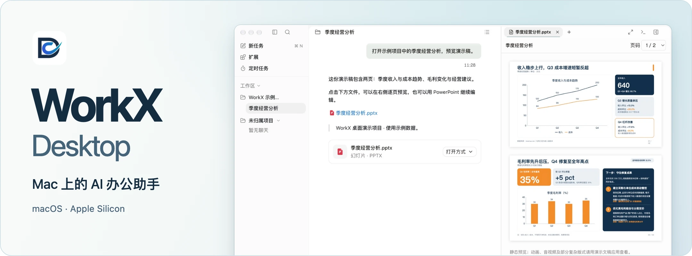
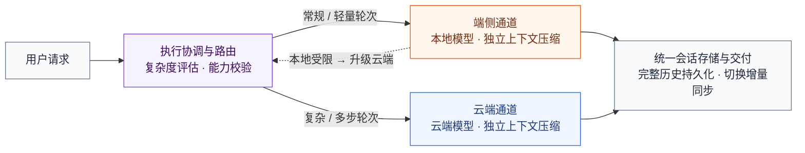

<!--
  Licensed to the Apache Software Foundation (ASF) under one
  or more contributor license agreements.  The ASF licenses this file
  to you under the Apache License, Version 2.0 (the
  "License"); you may not use this file except in compliance
  with the License.  You may obtain a copy of the License at

      http://www.apache.org/licenses/LICENSE-2.0

  Unless required by applicable law or agreed to in writing,
  software distributed under the License is distributed on an
  "AS IS" BASIS, WITHOUT WARRANTIES OR CONDITIONS OF ANY
  KIND, either express or implied.  See the License for the
  specific language governing permissions and limitations
  under the License.
-->

<h1 align="center">WorkX Desktop</h1>

  <a href="docs/readme/workx-desktop.png">
    <picture>
      <source media="(max-width: 600px)" srcset="docs/readme/workx-cover.zh-CN.mobile.webp">
      
    </picture>
  </a>

<strong>让本地与云端模型在同一场对话中协作</strong>

中文 | <a href="README.en.md" lang="en" hreflang="en">English</a>

WorkX 是一款本地优先、支持端云协同的 AI 办公助手。下载本地模型后，就能在 Mac 上离线读文档、改草稿。核对多份报表、写分析报告时，混合模式会在同一段对话中按需调用本地或云端模型。

在 9 组办公和开发任务中，混合模式比全云模式少用了 **42.61%** 的云端 token，云端费用降低了 **38.05%**。

在「设置 → 模型」中可选用内置模型或免费订阅，也可接入自己的模型 API 或订阅账号。

## 快速开始

我们提供了适用于 Apple Silicon 的安装包，支持 macOS 26 及以上版本，欢迎下载体验。

1. **安装应用**　[下载 WorkX 0.1.0 安装包](https://github.com/AMAP-ML/WorkX/releases/download/0.1.0/WorkX-0.1.0-mac-arm64.dmg)，打开 `.dmg` 文件，将 WorkX 拖入「应用程序」。
2. **首次启动**　从「应用程序」打开 WorkX，复制 [0.1.0 发布页](https://github.com/AMAP-ML/WorkX/releases/tag/0.1.0)上的激活码，按提示粘贴即可激活。
3. **配置模型**　打开「设置 → 模型」，选择本地或云端模型。查看[支持的模型](#支持的模型与接口)。

[办公体验](#办公体验) · [端云协同](#端云协同) · [端侧推理](#端侧推理优化) · [社群](#社群)

## 办公体验

WorkX 支持对照文档、表格、PDF 和网页资料，用 Word 报告汇总要点、用 Excel 图表展示数据、用 PPT 呈现结论。

### 文件排版

本次评测中，WorkX 的文件排版位居前列。Excel 排名第一，PPT 的平均名次与 WorkBuddy 相差 0.02。

| 美观度平均排名 | WorkX | Codex | WorkBuddy |
| --- | ---: | ---: | ---: |
| Excel | **1.63** | 3.29 | 1.94 |
| PowerPoint | 2.41 | 2.93 | **2.39** |

### 项目与工具

WorkX 支持在对话旁直接预览文档、表格、PPT 和 PDF，也支持按项目管理对话和文件。任务在进行中，WorkX 也能实时显示当前进度和工具调用记录。

WorkX 还可以编辑代码、执行命令，也能通过浏览器查找资料。你可以把常用流程写成 Skill，安排任务定时运行，通过 MCP 接入外部工具，或让多个 Agent 分工协作。

### 公开 Benchmark 测评

#### Harness-bench

| 类别（任务数） | WorkX 得分 | Codex 得分 |
| --- | ---: | ---: |
| 代码（29） | 70.87 | **73.95** |
| 办公（38） | 75.42 | **75.68** |
| 通用（39） | 75.73 | **76.23** |

#### WorkBuddy-Bench

WorkX 的代码和网页任务得分分别比 Codex 高 0.77 分和 3 分。

| 类别（任务数） | WorkX 得分 | Codex 得分 |
| --- | ---: | ---: |
| 代码（80） | **66.89** | 66.12 |
| 办公（50） | 72.94 | **74.47** |
| Web（70） | **56.04** | 53.04 |
| 安全（60） | 52.03 | **53.91** |

#### 平均 Token 用量

本次评测中，WorkX 平均使用 83,470 个 token，比 Codex **少 12.68%**。

| 效率指标 | WorkX | Codex | WorkX 相对 Codex |
| --- | ---: | ---: | ---: |
| 平均 Token 用量 | **83,470** | 95,592 | **少 12.68%** |

## 端云协同

混合模式可以根据每轮任务的复杂度自动选择模型。以销售表分析为例，Mac 上的本地模型即可解释同比公式。需要按月份对齐两年的销售表并计算各月同比增长率时，WorkX 会自动交给云端处理。

云端接手本地任务时，可沿用此前的要求和工具已读取的数据，在同一段对话中继续追问即可无缝衔接处理。

### 支持的模型与接口

| 接入方式 | 可选模型或服务 |
| --- | --- |
| 本地模型（仅 MLX） | 在 WorkX 内下载 LFM3-1.7B 或 MiniCPM-V 4.7 |
| 免费云端模型 | Kilo Free、OpenCode Free、OpenRouter（需登录） |
| 云端 API | OpenAI、Anthropic、Gemini、阿里云百炼（Qwen）、DeepSeek 等 |
| 订阅账号 | GitHub Copilot、Claude Pro / Max、ChatGPT / Codex 等 |
| 自建网关兼容接口 | OpenAI Chat Completions、OpenAI Responses、Anthropic Messages |

### 云端用量和费用

使用 MiniCPM-V-4.7-35B-A3B 作为本地模型，在 9 组办公和开发任务中对比混合模式与全云模式。相比全云模式，混合模式的云端 token 用量降低 **42.61%**，估算的云端费用降低 **38.05%**。

| 9 组任务的结果 | 全云模式 | 混合模式 | 较全云模式节省 |
| --- | ---: | ---: | ---: |
| 云端 token 用量（以全云模式为基准） | 100% | 57.39% | **42.61%** |
| 估算的云端模型费用 | 19.54 美元 | 12.11 美元 | **38.05%**（约 7.43 美元） |

## 端侧推理优化

面向 **Apple Silicon**，基于 MLX 优化本地推理。提供轻量文本模型 **LFM3-1.7B** 和支持图文理解的 **MiniCPM-V 4.7**。

### 推理加速

通过低比特量化降低内存占用、提升推理速度，MiniCPM-V 4.7 同时支持 DSpark 投机解码加速。

| 模型 | 生成速度（Token/s） | 生成加速 | 加载内存 | 内存下降 |
| --- | ---: | ---: | ---: | ---: |
| LFM3-1.7B | 75.04 → **212.25** | **2.83×** | 3.22 → **0.91 GiB** | **71.9%** |
| MiniCPM-V-4.7-35B-A3B | 34.11 → **113.08** | **3.32×** | 65 → **15.65 GiB** | **75.9%** |

> 注：测试芯片为 Apple M5 Pro，采用短上下文。

### KV Cache 分层管理

按运行中、内存、磁盘分层管理缓存，复用系统提示词、工具定义和对话历史。支持会话切换与重启恢复，减少重复计算，缩短首 Token 等待。

| 模型 | 缓存命中率 | 首 Token 等待时间 |
| --- | ---: | ---: |
| LFM3-1.7B | **88.31%** | 4.19 → **0.79 秒** |
| MiniCPM-V 4.7 | **88.16%** | 12.14 → **2.35 秒** |

> 注：基于真实多轮会话回放统计，缓存命中率按全部输入 Token 计算，包含工具调用返回内容。

### 自适应热控

根据温度与风扇状态动态调节推理负载，以适度延长任务耗时换取更低的功耗与噪声。

| GPU 平均功率变化 | GPU 温度峰值变化 | CPU 温度峰值变化 | 风扇峰值变化 | 任务总耗时变化 |
| ---: | ---: | ---: | ---: | ---: |
| **−23.5%** | **−1.6 ℃** | **−2.3 ℃** | **−36.6%** | **+31.5%** |

### 支持 MiniCPM-V 4.7 前瞻专家调度（LES）

- **按需加载**：18–24 GB Apple Silicon Mac 默认启用，按需读取专家权重。

- **降低内存**：20K 上下文测试中，MLX 峰值内存下降 **30.8%**。

- **动态缓存**：启动时按可用内存规划专家缓存，每轮按负载调整缓存大小，复用权重减少 SSD 读取。

## 社群

用 WorkX 时，哪一步帮你省了时间？哪儿用着还不顺手？欢迎加入我们的社群交流讨论！

<!-- 社群二维码位置。 -->

## 致谢

以下开源项目为 WorkX 的设计与实现提供了参考。感谢各项目的维护者和贡献者。

- 桌面工作区设计 · [Apache Maka](https://github.com/apache/maka)
- 模型调用与 Agent 运行机制 · [Pi](https://github.com/earendil-works/pi)
- 文件编辑与工具输出处理 · [OpenCode](https://github.com/anomalyco/opencode)
- Apple 芯片上的本地推理 · [MLX](https://github.com/ml-explore/mlx)
